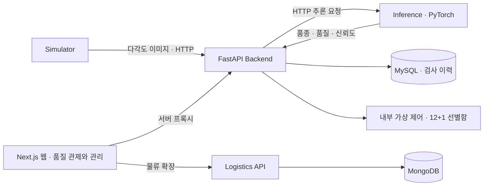

# 🍎 CQC · 사과 품질 판정 및 선별 시스템

> 다각도 이미지 판정부터 가상 선별·품질 관제까지, 하나의 검사 흐름으로 연결하다.

사과의 다각도 이미지를 AI로 분석해 **품종과 품질 등급을 판정**하고, 저신뢰·오류 재검사와 가상 선별 결과를 관제 화면에서 확인하는 서비스입니다.

**4인 팀 프로젝트를 홍유나의 개인 포트폴리오로 정리한 통합 저장소**입니다. 데이터·모델, 검사 API, Simulator, 품질 관제 웹과 물류 확장 코드를 함께 보관했으며, 개인 담당은 **MLOps·CI/CD, 공통 실행 환경, 배포·복구와 수용시험 자동화**입니다.


## 프로젝트 개요

| 항목 | 내용 |
| --- | --- |
| 개발 기간 | 2026.09.16 ~ 2026.10.16 |
| 정리 기준 | 2026.10.13 · 기능 동결일, 최종 수용 판정 진행 중 |
| 구성 | 4명 · 데이터·모델 / 프론트엔드 / 백엔드·DB / MLOps·CI/CD |
| 대상 | 부사·양광 2개 품종, 특·상·보통 3개 품질 등급 |
| 입력 | 같은 사과의 다각도 이미지, 기본 12장 |
| 판정·선별 | 품종·품질 확률과 신뢰도, 정상 12개 선별함 + 재검사함 1개 |
| 운영 환경 | RAM 16GB 서버컴 · GPU 없는 CPU Docker 환경 |
| 개인 담당 | Docker Compose, Jenkins·GitHub Actions, 배포 복구, 운영 검증·QA 자동화 |

한 건의 검사는 사진 한 장이 아니라 **사과 한 개의 이미지 묶음**입니다. 동일한 `inspection_id`로 입력·추론·제어·저장 결과를 추적합니다. 정상 선별함은 품종 2종 × 외관 등급 3종 × 가상 당도 2단계로 구성하며, 당도는 센서 실측이나 AI 예측값이 아닌 **시연용 가상 값**입니다.

## 주요 기능

| 영역 | 구현 내용 |
| --- | --- |
| AI 판정 | MobileNetV3 Small 기반 다각도 품종·품질 판정, 신뢰도·모델 버전 반환 |
| 자동 입력 | Simulator 이미지 묶음 전송, 정지·재개, 입력 간격·동시 처리 수 설정 |
| 가상 선별 | 정상 선별함 결정, 저신뢰·추론 오류·시간 초과의 재검사 분기 |
| 품질 관제 | 처리 중 사과 12장, 재검사·오류 목록, 처리량 그래프, 구성요소 상태 |
| 품질 관리 | 검사 이력·기간 통계, 필터·CSV, 검수 이미지·오판 의심 표시 |
| 운영·검증 | healthcheck, 재시작 위치 복구, 로그 순환, 장애 주입·수용시험 기록 |
| 물류 확장 시연 | 입찰·낙찰 → 가상 결제 → 배차·배송 관제 화면 |

실제 산업용 카메라·PLC·선별 장비는 연결하지 않았습니다. 물류 확장은 품질 검사 MVP 밖의 시연 범위이며, 결제 화면도 실결제가 없는 가상 흐름입니다.

## 홍유나 담당 업무

### 1. 공통 실행 환경과 서비스 상태 확인

- 초기 5개 서비스의 Docker Compose 골격을 만들고, 팀원(조현재)이 연결한 물류 3개를 포함해 품질 검사 4개·물류 3개, **총 7개 서비스** 구성을 관리
- MySQL·Inference 준비 후 Backend, Backend 준비 후 Simulator·웹이 기동하도록 의존성 구성
- 컨테이너 실행 여부에 더해 Simulator의 실제 재생·최근 검사 전송 성공을 healthcheck로 확인
- 데이터셋 읽기 전용 연결, 입력 위치·DB·검수 이미지·로그의 영속 볼륨 관리

### 2. CI/CD와 실패 시 복구

- GitHub Actions의 `dev` 대상 PR 검사와 Jenkins의 `dev` 통합 배포 흐름 구성
- Python·웹 테스트를 통과한 버전만 이미지 빌드·배포
- 배포 전 실제 실행 이미지 ID·설정·볼륨·네트워크를 저장하고 배포 후 상태 확인 실패 시 이전 구성으로 복구
- 실패한 복구 기록을 보존해 다음 실행에서 재시도하도록 처리

### 3. 운영 검증과 수용시험 자동화

- HTTP 추론 반복 측정과 동시 처리 수 비교를 위한 CPU 시험 환경 제공
- 정상 100건 관찰, 장애 6종, 순환 보존·CSV·재시작 복구의 실행·기록 자동화
- 운영 환경 관찰과 격리 환경 시험을 구분하고 실행 이미지와 Jenkins 빌드 출처 대조
- 요청·응답 원자료와 SHA-256 목록을 보관해 결과를 다시 검토할 수 있도록 정리

모델 학습·선정은 DM, 검사 정책·DB는 BE, 관제 화면은 FE의 담당 범위입니다. 개인 구현 파일과 작업 근거는 [MLOps 담당 상세](docs/portfolio/mlops.md)에 정리했습니다.

## 서비스 구조



서비스 간 통신은 HTTP입니다. `logistics-web`이 품질 관제·관리와 물류 화면을 함께 제공하므로 별도 `frontend` 컨테이너는 없습니다. 과거 팀 문서에 남아 있는 서비스 개수와 달리, 현재 구성은 실제 [compose.yaml](compose.yaml)의 7개 서비스를 기준으로 합니다.

## 기술 스택

| 영역 | 기술 |
| --- | --- |
| 데이터·모델 | Python · PyTorch · torchvision · MobileNetV3 Small · 그룹 교차검증 |
| 검사 API·DB | FastAPI · SQLAlchemy · Alembic · MySQL 8.4 |
| 웹 | Next.js · React · TypeScript · Tailwind CSS · Chart.js |
| 물류 API·DB | FastAPI · MongoDB 8 |
| MLOps·CI/CD | Docker · Docker Compose · Jenkins Pipeline · GitHub Actions |
| 검증·협업 | pytest · Node.js test runner · GitHub Issue/PR · Notion |

## 팀 구성

| 이름 | 역할 | 주요 담당 |
| --- | --- | --- |
| 조현재 | 데이터·모델 | 데이터 정제·그룹 분할, 모델 학습·비교·선정, 추론 API |
| 강성민 | 프론트엔드 책임 | 화면 명세·품질 관제·관리 UI 영역 |
| 홍준희 | 백엔드·DB | 검사 오케스트레이션, 정책·가상 제어, 이력·통계·DB |
| **홍유나** | **MLOps·CI/CD** | **공통 Compose, 자동 검사·배포·복구, 운영·수용시험 자동화** |

팀의 최신 통합 문서는 FE 영역을 강성민 책임·조현재 구현으로 기록합니다. 역할·일정 원본은 [WBS](docs/wbs/WBS.md), 상세 협업 현황은 [ALL-03](docs/wbs/ALL-03.md)에서 확인할 수 있습니다.

## 문제 해결 사례

### Jenkins 테스트 컨테이너에서 소스를 찾지 못하던 문제

Jenkins에 Python·웹 테스트를 연결한 뒤 빌드가 5회 연속 실패했습니다. 단계별 로그를 확인하니 테스트 컨테이너에 요구사항 파일이 없거나 `src`를 import하지 못했습니다. Jenkins 컨테이너의 작업 경로를 호스트 Docker daemon이 동일하게 읽을 수 있다고 가정한 것이 원인이었습니다.

작업 폴더를 `docker cp`로 테스트 컨테이너에 복사하고 `python -m pytest`로 실행하도록 수정했습니다. 이후 해당 회차에서 **Python 287개·웹 46개 테스트 통과와 배포 성공**을 확인했습니다. 실패하는 동안에는 배포 전 단계에서 멈춰 기존 성공 버전을 유지했습니다. 이 수치는 당시 회차의 결과이며 현재 전체 테스트 수가 아닙니다.

### 배포 성공을 실제 검사 재생까지 확인

컨테이너가 실행 중이어도 Simulator 입력이 0건인 상태가 있었습니다. 기동 시 자동 재생을 연결하고, healthcheck와 Jenkins Verify가 `running`·`lastSeenAt`을 검사하도록 구성했습니다. 배포 완료 조건에 최근 검사 전송 성공을 포함해 프로세스 실행과 서비스 동작을 함께 확인하도록 바꿨습니다.

### 정상 100건 시험의 지연을 실패 증거로 보존

2026.10.12 시험에서는 시간 초과·추론 오류가 없었지만 완료 간격 p90과 최대 간격이 기준을 넘었습니다. 평균 처리량만 보면 문제를 놓칠 수 있어 **중앙값·p90·최대 간격을 함께 기록**하고 빌드·실행 이미지와 원자료를 연결했습니다. 실패 회차를 남기고 원인이 미확정인 부분은 다음 분석 대상으로 정리했습니다.

구체적인 원인·수정 파일·검증 범위는 [문제 해결 기록](docs/portfolio/troubleshooting.md)에 있습니다.

## 검증 결과와 남은 과제

| 항목 | 확인한 결과 | 해석 |
| --- | --- | --- |
| 10.12 배포 출처 | Jenkins #139, 실행 이미지와 빌드 digest 4/4 일치 | 해당 회차의 배포 버전 확인 |
| 10.12 정상 100건 | 0.472건/초, 재검사 9%, 시간 초과·추론 오류 0건 | 일부 기준 충족 |
| 같은 회차의 지연 | p90 2.526초, 최대 간격 5.755초 | 각각 2.2초 이하·4초 미만 기준 **미충족** |
| 10.13 SIM-04·05 | revision 충돌 409·상태 유지, 잘못된 설정 10종 422·상태 불변 | MO 실행 기대값 충족, 공식 판정은 BE 검수 후 반영 |
| 초기 처리 목표 | 초당 2건 | 현재 구조에서 미달, 시연 기본 간격 2초 |
| 모델 품질 | 개발 5-fold 품질 Macro F1 0.8844, source holdout 0.7932 | 팀 모델 결과, 독립 holdout 승인 전 후보 |

원본 결과와 해석은 [검증 근거](docs/portfolio/validation.md)에 연결했습니다. 과거 성공 회차로 최신 실패를 대체하지 않았으며 전체 최종 수용시험 완료로 표시하지 않습니다.

## 주요 화면

팀에서 발표용으로 보관한 실행 화면입니다. 관제·관리·결제는 2026.10.08, 검수 이미지·설정은 10.07 캡처입니다. 이번 정리에서 새로 촬영하거나 전체 서비스를 재검증한 화면은 아닙니다.

### 품질 관리 · 검사 이력


기간·품종·등급·처리 상태 필터와 CSV 내보내기, 추론·제어·저장 결과를 함께 확인합니다.

<details>
<summary>검수 이미지 · 시연 설정 · 물류 확장 화면</summary>

### 검수 이미지


### 시연 설정


### 물류 확장 · 가상 결제


실결제가 없는 자동 경매·가상 결제·배차 시연입니다.

</details>

## 저장소 구성

| 위치 | 내용 |
| --- | --- |
| [src](src) | 데이터·모델·학습·추론, 검사 API·Simulator |
| [cqc-logistics-platform](cqc-logistics-platform) | Next.js 웹과 물류 API |
| [models](models) · [configs](configs) | Git으로 관리하는 모델 패키지·설정 |
| [compose.yaml](compose.yaml) · [Jenkinsfile](Jenkinsfile) | 공통 실행 환경·CI/CD |
| [scripts/ci](scripts/ci) · [scripts/qa](scripts/qa) | 배포·복구·검증 자동화 |
| [tests](tests) | API·모델·Simulator·배포 스크립트 검증 |
| [docs/portfolio](docs/portfolio) | 개인 담당·문제 해결·검증 근거 |
| [README.team.md](README.team.md) · [docs/wbs](docs/wbs) | 원본 팀 안내·작업 기록·결과 |
| [SOURCE.md](SOURCE.md) | 가져온 저장소·커밋·보존 범위 |

## 실행 방법

Docker·Docker Compose와 별도 시연 데이터셋이 필요합니다. AI Hub 원본 이미지와 가공 데이터는 Git에 포함되지 않습니다. 모델 패키지는 `models/selected`에 보관합니다.

```powershell
git clone https://github.com/h-yuna-lab/CQC.git
cd CQC
Copy-Item .env.example .env
```

`.env`에서 DB 비밀번호와 내부 인증 토큰을 설정하고 로컬 환경에서는 다음 공개 주소를 사용합니다.

```dotenv
LOGISTICS_PUBLIC_WEB_ORIGIN=http://localhost:3100
LOGISTICS_PUBLIC_API_URL=http://localhost:8100/api/v1
```

[데이터셋 준비 안내](docs/wbs/reference/MO/simulator-deployment.md)에 따라 `index.json`·`demo-virtual-brix.csv`·`groups/`·`partial_groups/`를 담은 외부 볼륨 `cqc_simulator_dataset`을 준비한 후 실행합니다.

```powershell
docker compose -p cqc-portfolio up -d --build
docker compose -p cqc-portfolio ps
```

| 대상 | 기본 주소 |
| --- | --- |
| 웹 · 품질 관제와 관리 | http://localhost:3100 |
| 검사 API | http://localhost:8000/docs |
| 추론 API | http://localhost:8001/health |
| 물류 API | http://localhost:8100/docs |

실행·CI 운영·복구 조건은 [담당 상세](docs/portfolio/mlops.md)와 [팀 문서 안내](docs/wbs/README.md)를 참고합니다. 이번 정리에서는 기존 운영 서비스의 새 빌드·배포를 실행하지 않았습니다.

## 프로젝트 회고

서비스를 한 번 실행하는 것보다 다른 파트의 변경을 같은 환경에서 반복 검증하고 실패했을 때 돌아갈 수 있게 만드는 일이 MLOps의 핵심이라는 점을 배웠습니다. Jenkins와 Docker daemon이 서로 다른 파일 경로를 보는 문제를 해결하면서 로컬에서 통과한 명령도 실제 실행 위치와 권한·파일 전달 방식까지 확인해야 한다는 것을 경험했습니다.

또한 추론이 빠르고 컨테이너가 healthy이며 저장된 100건에 오류가 없어도 전체 흐름이 요구사항을 만족한다고 판단할 수 없었습니다. 이미지 전송, 처리 완료 간격, 저장·복구까지 관찰하고 실행 코드와 운영 이미지의 출처를 구분해 기록하는 습관을 얻었습니다.

앞으로는 미충족한 p90·최대 간격의 원인을 단계별 시간 측정으로 좁히고 배포 이미지에 Git SHA를 자동으로 남겨 출처 확인을 단순화하고 싶습니다. 최종 모델의 독립 평가와 QA 잔여 판정도 팀의 담당자 확인을 거쳐 마무리할 계획입니다.

## 출처

- [원본 팀 저장소](https://github.com/yuudong123/CQC)
- [가져온 기준 및 보존 범위](SOURCE.md)
- [홍유나 MLOps 상세](docs/portfolio/mlops.md) · [문제 해결](docs/portfolio/troubleshooting.md) · [검증 근거](docs/portfolio/validation.md)
