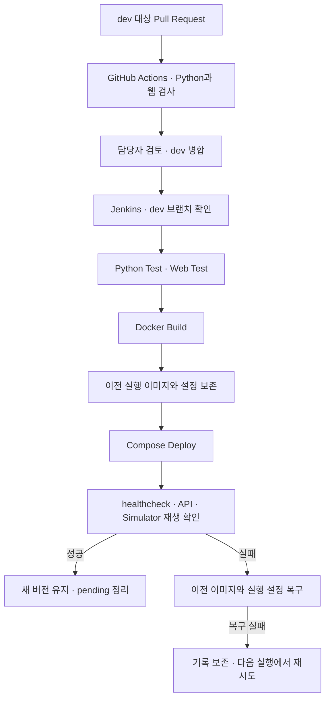

# 홍유나 · MLOps·CI/CD 담당 상세

모델·API·화면 파트의 실행 단위를 연결하고 검증된 버전을 반복 배포·확인·복구할 수 있도록 공통 환경을 담당했습니다. 모델 학습과 검사 정책·화면 전체 구현은 각 담당자의 작업입니다.

## 담당 코드와 근거

| 작업 | 확인할 파일 | 역할 |
| --- | --- | --- |
| 서비스 통합 | [compose.yaml](../../compose.yaml) | CPU 추론·검사·Simulator·물류·웹 실행 환경 |
| CI·배포 | [Jenkinsfile](../../Jenkinsfile), [PR checks](../../.github/workflows/pr-checks.yml) | PR 검사, dev 통합 검사·빌드·배포·검증 |
| 배포 상태 보존 | [snapshot-compose.py](../../scripts/ci/snapshot-compose.py), [preserve-compose-images.sh](../../scripts/ci/preserve-compose-images.sh) | 실제 이미지 ID·실행 구성 기록, 이전 이미지 보존 |
| 배포·복구 | [compose-deploy.sh](../../scripts/ci/compose-deploy.sh), [compose-rollback.sh](../../scripts/ci/compose-rollback.sh) | 교체·실패 복구·pending 기록 처리 |
| 상태 확인 | [verify-compose-health.sh](../../scripts/ci/verify-compose-health.sh) | 배포 후 서비스 준비 상태 검증 |
| 수용시험 | [run_mo09_acceptance.py](../../scripts/qa/run_mo09_acceptance.py) | 운영 관찰·격리 회귀, 원자료·QA 기록표 출력 |
| 장애·재시작 | [run_mo09_e2_faults.py](../../scripts/qa/run_mo09_e2_faults.py), [run_mo09_e2_recovery.py](../../scripts/qa/run_mo09_e2_recovery.py), [run_mo09_e2_restart.py](../../scripts/qa/run_mo09_e2_restart.py) | 격리 장애 주입, 중단·복구, 입력 위치·보존 결과 확인 |
| 배포 출처 | [collect_mo09_followup.py](../../scripts/qa/collect_mo09_followup.py) | checkout SHA·빌드 digest·실행 이미지 대조 |

파일에는 팀 연동 과정의 공동 변경도 포함됩니다. 담당 근거는 [WBS](../wbs/WBS.md), [전체 현황](../wbs/ALL-03.md), [MO-09 작업 기록](../wbs/MO-09.md)입니다.

## 공통 실행 환경

현재 서비스는 `mysql`, `inference`, `backend`, `simulator`, `logistics-mongodb`, `logistics-api`, `logistics-web`의 7개입니다. 품질 관제·관리 화면도 `logistics-web`에서 제공합니다.

- MySQL·Inference healthy 이후 Backend를 시작하고 Alembic migration을 적용합니다.
- Backend 준비 이후 Simulator와 웹을 시작합니다.
- 데이터셋은 읽기 전용으로 연결하고 재생 위치는 별도 쓰기 볼륨에 보관합니다.
- DB·검수 이미지·로그는 컨테이너 재생성과 분리해 보존합니다.
- 로그 기본 설정은 파일당 10MiB·백업 5개입니다.

Simulator는 `/health`에서 `running=true`와 최근 30초 내 성공 전송 시각을 함께 확인합니다. 단순 프로세스 실행 상태 외에 실제 입력 진행을 배포 완료 조건으로 사용했습니다. [자동 재생·상태 계약](../wbs/reference/MO/simulator-deployment.md)에 상세 조건이 있습니다.

## 검사에서 배포까지



Jenkins는 팀의 `dev`만 자동 배포합니다. GitHub Actions는 PR 검사이며 운영 배포를 실행하지 않습니다. 포트폴리오 `main` 등록은 팀 서버 배포와 별개입니다.

Python 검사는 서비스와 같은 Python 3.11에서 API·Simulator·CI 스크립트·서비스 로깅을 대상으로 합니다. 웹은 Node.js 24에서 시험합니다. torch 학습·추론 전체 테스트와 실제 MySQL 통합 시험은 이 Jenkins 단계의 필수 범위가 아닙니다.

## 복구 범위와 한계

배포 전 실제 컨테이너의 이미지 ID·환경변수·명령·healthcheck·포트·볼륨·네트워크를 기록합니다. 기존에 실행되던 구성을 복구 기준으로 삼아 새 Compose 파일이 변경됐어도 이전 설정으로 돌아갈 수 있게 했습니다.

검사 실패 시 교체 전 서비스를 유지합니다. 교체 이후 실패, Jenkins 취소·시간 초과에는 복구를 시도하고 이전 서비스의 상태 확인이 끝나야 pending 기록을 지웁니다. 에이전트 단절·강제 종료 직후 복구는 보장되지 않으며 같은 워크스페이스의 다음 실행에서 재시도합니다.

교체 과정에 서비스 중단이 있을 수 있으므로 무중단 배포는 아닙니다. DB 데이터·migration은 되돌리지 않으며 이전 이미지와 migration의 호환성이 필요합니다. 첫 배포는 이전 버전이 없어 같은 방식으로 복구할 수 없습니다. 자격 증명을 포함하는 복구 기록은 Git·빌드 컨텍스트·Jenkins artifact에서 제외합니다.

세부 계약과 실패 주입 절차: [Jenkins 안전 배포](../wbs/reference/MO/jenkins-safe-deployment.md).

## 검증 도구 사용

운영 관찰은 읽기 전용 조회와 Docker 상태 확인을 사용하고 장애·보존·DB 변경 시험은 별도 Compose 프로젝트와 시험 DB에서 수행합니다. 정상 100건 측정과 격리 부하 시험은 동시에 실행하지 않습니다.

```powershell
# 시험 전용 MySQL을 만들고 회귀 시험 후 정리
python scripts/qa/run_mo09_acceptance.py --mode isolated --disposable-mysql --actor "홍유나"
```

성공 종료는 선택한 자동 검사 통과이며 전체 ALL-04 수용 승인을 뜻하지 않습니다. [MO-09](../wbs/MO-09.md)의 준비 조건·격리 범위를 확인해야 합니다. 이번 정리에서는 시험을 새로 실행하거나 운영 DB·컨테이너를 변경하지 않았습니다.
